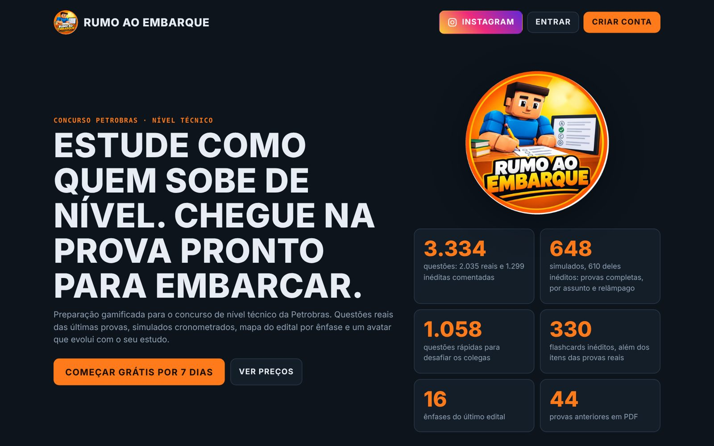
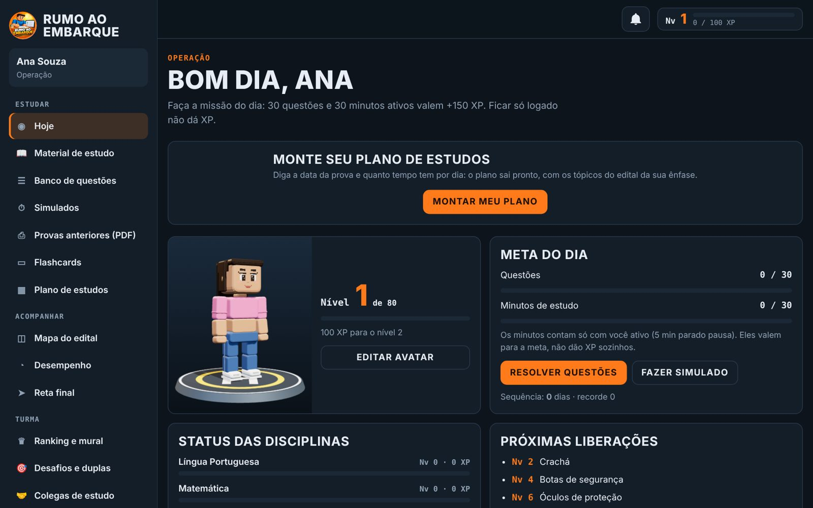
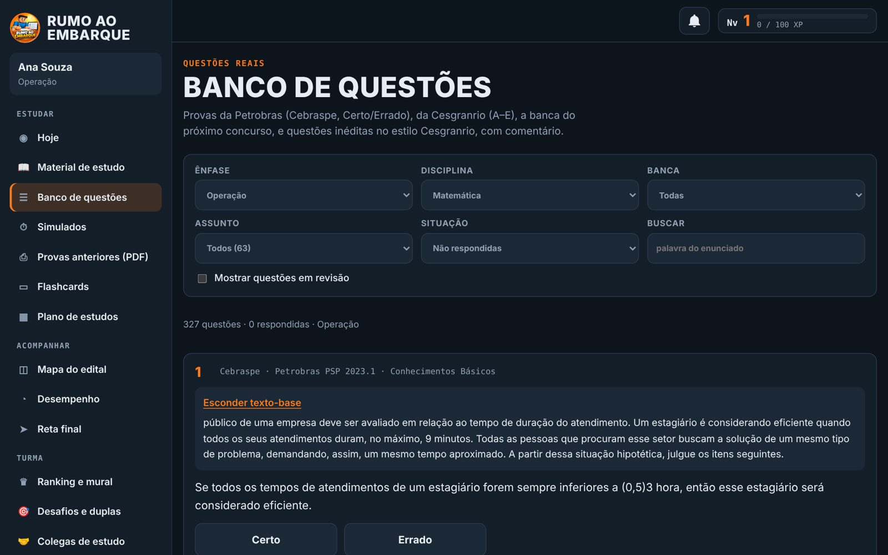
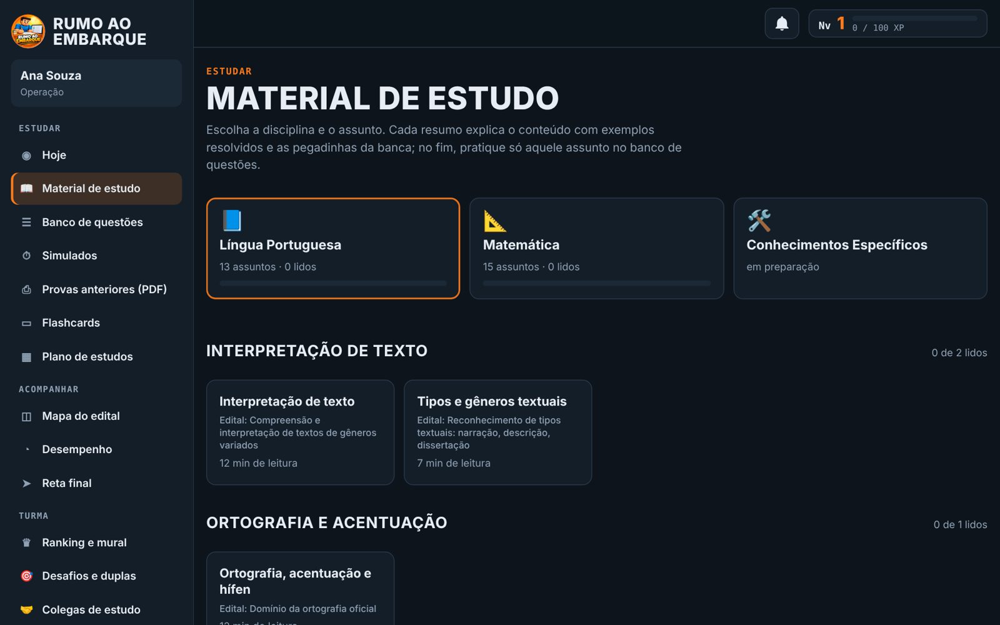
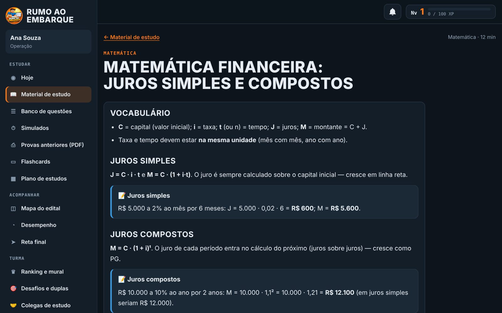
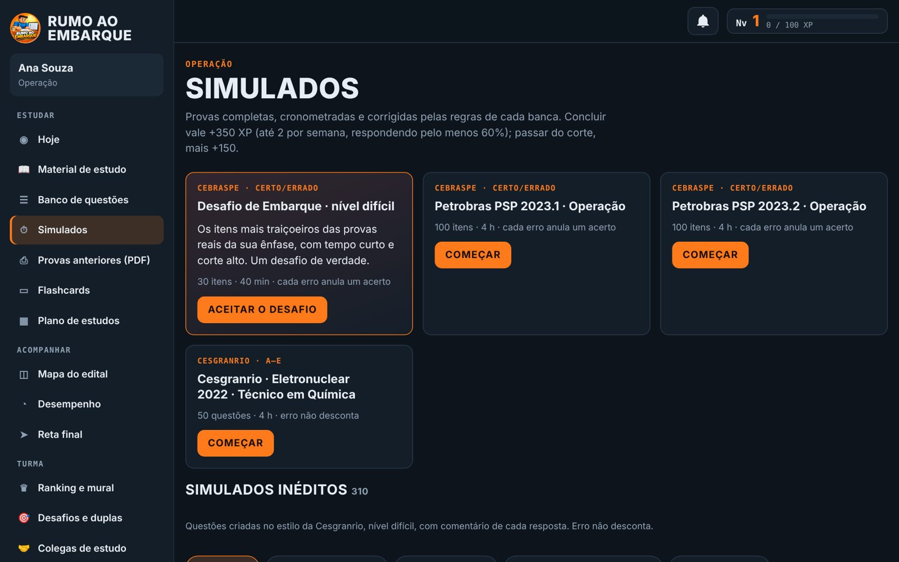
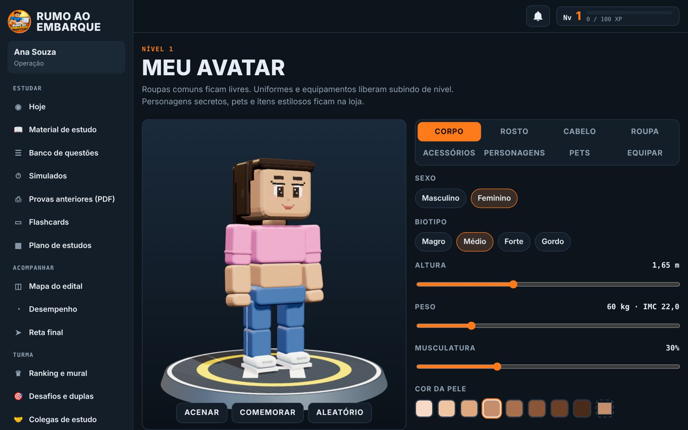
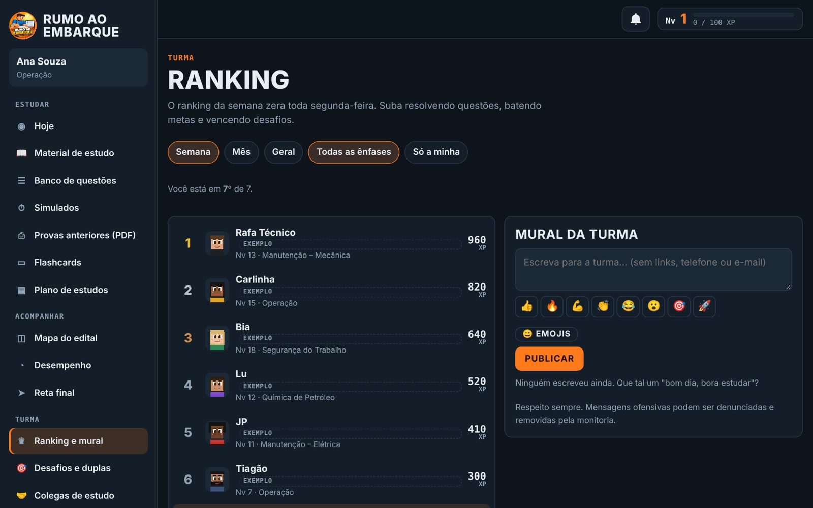
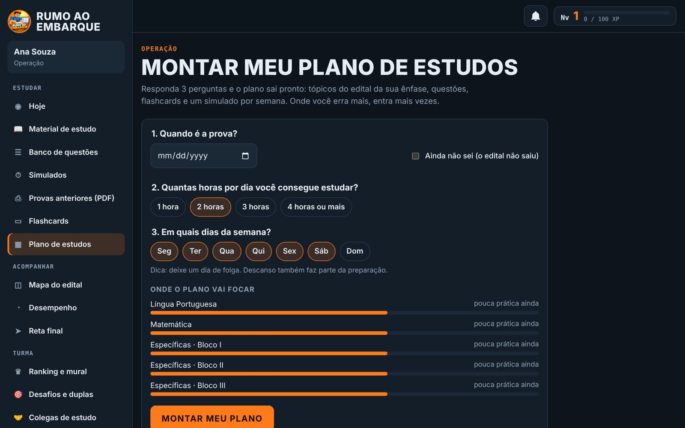
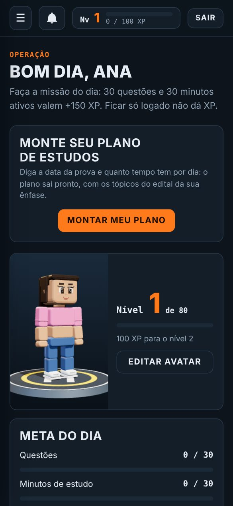

  

<h1 align="center">🛢️ Rumo ao Embarque</h1>

  <b>Plataforma gamificada de preparação para o concurso de nível técnico da Petrobras.</b> 
  Questões reais, simulados cronometrados, material de estudo e um avatar 3D que evolui junto com o aluno.

  
  
  

  
  
  
  
  
  
  

> **Este repositório é uma vitrine.** O código-fonte da plataforma é privado; aqui estão a descrição do projeto, as telas e as decisões técnicas.

---

## 📌 Sobre o projeto

O concurso da Petrobras para nível técnico tem muitos candidatos e um edital longo, dividido em 16 ênfases. Estudar sozinho por PDF cansa rápido. O **Rumo ao Embarque** transforma essa preparação em um jogo: cada questão resolvida, meta diária cumprida e desafio vencido dá XP, o aluno sobe de nível (1 a 80) e libera equipamentos para o seu avatar, como crachá, botas e óculos de proteção, até o uniforme completo de quem embarca.

A plataforma está **no ar e com usuários reais**. Foi idealizada, desenhada e desenvolvida por mim, do conteúdo ao deploy.

## 📊 Em números

| | |
|---|---|
| **3.334** questões | 2.035 de provas reais e 1.299 inéditas comentadas |
| **648** simulados | provas completas, por assunto, só específicas, só básicas e relâmpago |
| **1.058** questões rápidas | exclusivas para desafios entre colegas |
| **330** flashcards | inéditos, além dos itens das provas reais |
| **28** resumos | Português e Matemática, organizados por área e assunto |
| **16** ênfases | todas as do último edital, com mapa do edital por ênfase |
| **80** níveis | com itens de avatar liberados por progresso |

## ✨ Funcionalidades

**Estudo**
- 📝 **Banco de questões** com filtros por disciplina, assunto, banca, ano e ênfase, e comentário em cada questão inédita
- ⏱️ **Simulados cronometrados** com correção automática e desempenho por disciplina
- 📖 **Material de estudo** organizado em disciplina → área → assunto (ex.: *Português → Interpretação de texto*), com botão "Praticar este assunto" que leva direto às questões
- 🗂️ **Flashcards** de certo/errado para revisão rápida
- 📅 **Plano de estudos** gerado a partir da data da prova, do tempo disponível por dia e da ênfase do aluno
- 🗺️ **Mapa do edital** e painel de desempenho por tópico

**Gamificação**
- 🎮 XP, níveis, missões diárias e sequência de dias estudados
- 🧍 **Avatar 3D** personalizável (corpo, rosto, cabelo, roupa, acessórios, pets), renderizado com three.js
- 🛍️ Loja de itens do avatar com pagamento via **Pix**: o BR Code (com CRC16) é gerado no próprio app

**Social**
- 🏆 Ranking semanal, mensal e geral, com filtro por ênfase
- 💬 Mural da turma, chat, colegas de estudo, desafios 1×1 e duplas
- 🔔 Central de notificações (amizades, desafios, novidades, compras)
- 🛡️ Moderação: denunciar, bloquear e painel da monitoria para tratar denúncias

**Plataforma**
- 👩‍💼 Painel administrativo da monitoria: alunos, acessos, pedidos da loja, novidades e denúncias
- 📱 **PWA**: instalável na tela inicial do celular (Android e iPhone)
- 🔐 Login com Google e e-mail, 7 dias de teste grátis e planos de assinatura
- ⚖️ Política de privacidade alinhada à **LGPD**

## 🖼️ Telas

<table>
  <tr>
    <td>
Painel do dia: meta, nível e avatar
</td>
    <td>
Banco de questões com filtros
</td>
  </tr>
  <tr>
    <td>
Material de estudo por área
</td>
    <td>
Leitura de um resumo
</td>
  </tr>
  <tr>
    <td>
Simulados por tipo
</td>
    <td>
Editor do avatar 3D
</td>
  </tr>
  <tr>
    <td>
Ranking e mural da turma
</td>
    <td>
Plano de estudos
</td>
  </tr>
</table>

   
  Versão para celular (PWA)

## 🧱 Arquitetura e tecnologias

| Camada | Tecnologia | Uso |
|---|---|---|
| Front-end | **React 18 + Vite** | SPA com roteador por hash e estado global próprio (`useSyncExternalStore`) |
| 3D | **three.js** | Avatar em voxel, com animações e itens equipáveis |
| Autenticação | **Firebase Auth** | Login com Google e e-mail/senha |
| Banco de dados | **Cloud Firestore** | Progresso, perfis, social e loja, protegidos por regras de segurança validando cada campo |
| Hospedagem | **Cloudflare Pages** | Deploy estático com `_worker.js` para rotas especiais |
| Pagamentos | **Pix (BR Code)** | Payload EMV e CRC16 gerados no cliente, com confirmação pela monitoria |
| Conteúdo | **Python** | Pipeline que gera, valida e monta o banco de questões, simulados e resumos em JSON |
| Testes | **Playwright** | Testes ponta a ponta dos fluxos principais, com Firebase simulado |

**Algumas decisões técnicas**
- **Conteúdo como dados.** Questões, simulados e resumos são JSON carregados sob demanda. O app não precisa ser reconstruído para crescer o banco.
- **Geração validada.** As questões inéditas saem de geradores em Python que conferem gabarito único, alternativas sem repetição e distratores plausíveis antes de entrar no banco.
- **Segurança no servidor.** As regras do Firestore limitam o que cada aluno pode gravar: só o próprio progresso, sem alterar XP de outros, com tamanhos e tipos validados.
- **Renderização segura.** O material de estudo usa um renderizador de Markdown próprio, sem HTML cru.
- **Notificações sem custo extra.** As notificações são derivadas dos dados que o app já escuta, e o estado de "lida" fica no aparelho.

## 🗺️ Próximos passos

- [ ] Material de estudo das disciplinas específicas por ênfase
- [ ] Página "Reta final" com revisão intensiva
- [ ] Pagamento por cartão

## 👤 Autor

**Plinio Martins**: idealização, design, desenvolvimento e conteúdo.

## ⚖️ Licença

© 2026 Plinio Martins. **Todos os direitos reservados.**

Este repositório existe apenas para apresentar o projeto. O código-fonte, o banco de questões, os textos e as imagens da plataforma não estão licenciados para cópia, modificação ou redistribuição.

*Projeto independente, sem vínculo com a Petrobras.*
